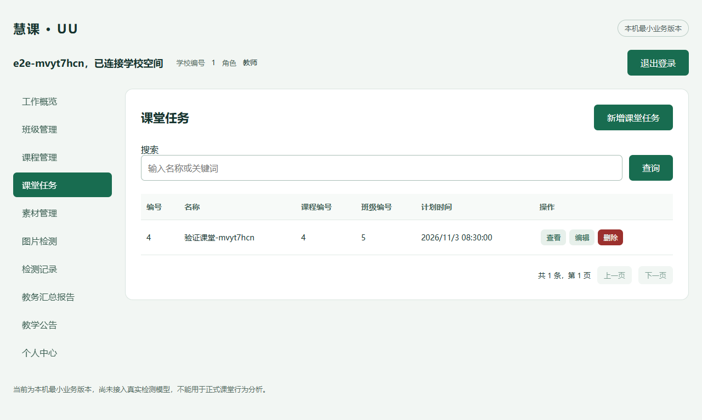
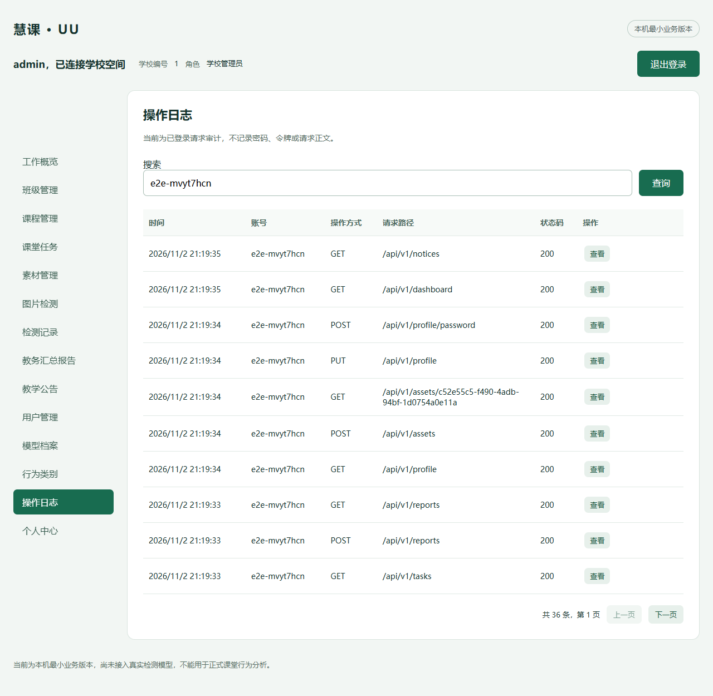

# 本机最小业务版本验收记录

日期：2026-11-02。项目根目录：`D:\self\uu_smart_classroom_cv`。原提交基线为`b4762b0cdadc1e1a6fca3bb4958e1a9dfa85c621`，本轮变更尚未提交或推送。

## 已交付及边界

在原三模块架构内实现真实本机业务，不另建演示项目。使用MySQL8.4.8及Redis5.0.14；业务与测试分别使用新建专用库、独立随机账号和Redis逻辑库。应用启动仅绑定127.0.0.1。

本轮交付学校隔离的班级/课程/课堂任务CRUD，本校账号管理、资料/头像/原密码改密、公告发布、模型/类别档案、请求审计、教务计数、图片素材管理、真实检测不可用时的失败记录，以及明确标注本地来源的教务模板/PDF。

真实模型、行为统计、AI、视频、摄像头及边缘协议没有交付。没有检测成功路径，不把失败记录或教务报告算作模型检测与AI分析完成。生产门禁明确拒绝放行，可信生产证据验证器仍未实现。

## 实测结果

| 层级 | 命令/方式 | 本轮结果 |
| --- | --- | --- |
| 根规则及本机环境隔离 | unittest + quality_gate | 10项通过 |
| Java基础 | Maven verify | 9项单元通过，构建/格式通过 |
| 真实MySQL/Redis HTTP | python scripts/local_dev.py test | 21项通过，无失败、无跳过 |
| 前端 | npm run verify | 5项测试通过，类型、格式及双端构建通过 |
| FastAPI | uv run pytest及Ruff | 11项通过，错误响应对照提交契约校验 |
| Chrome真实双端 | npm run test:e2e | 17项通过，无API fixture拦截 |
| 旧审计反例 | docs/qa/audit-cases/test_runtime_boundaries.py | 22项通过，原6个失败已转绿 |
| PDF | Chromium打印、文本提取及页面渲染 | 单页中文，编号/时间/正文及来源可读 |

各组测试有重叠，不累加为功能完成率。真实浏览器覆盖登录、创建教师、班级创建/编辑、课程/任务关联、计划时间回填、引用删除拒绝、模型档案、图片作业、素材预览、失败记录、教务报告/PDF、头像、改密、公告及日志；最终只清理本次临时账号和关联记录，保留请求审计。

根全检查初次因正在运行的Vite锁定原生依赖导致npm ci返回EPERM。停止本轮Vite后重新执行全检查成功，随后恢复服务，并重跑前端检查与浏览器验收。没有提权、删除门禁或忽略失败。

## 关键缺陷整改

- Redis5不支持Sa-Token更新所需的KEEPTTL：本机显式兼容模式用原子Lua保留TTL，并验证不存在的会话不会被复活。
- 非ASCII内部凭据不再触发500，返回401；401/422/503错误封装已进入OpenAPI并用真实响应校验。
- Java完全限定框架引用纳入扫描；它仍是基础静态检查，不能声称等同完整字节码架构验证。
- 普通文件和哈希不能放行生产：当前生产验证器失败关闭，明确提示可信来源验证器未实现。
- 独立检查发现旧测试全表删除及固定ID清理风险：认证测试复用受控fixture，创建前遇已占用学校编号拒绝覆盖，只有本次INSERT成功后才允许清理；新增保留既有fixture记录的回归测试。
- 管理员代教师上传：先服务端鉴权任务，再从任务确定素材负责人；不删除同owner检查或复合外键。
- 关联选项跨页加载，101条选项用例通过；新增素材管理以找回/预览/删除未绑定图片，保留头像和作业引用保护。
- 前端关联标签和ISO时间回填问题经真实浏览器复现后修复；显示时间按本机时区展示。

独立检查仅做只读审查，未读取凭据、写库、修改代码或代替实际运行。其两项重要问题和两项一般问题均已按上述测试/实现处理。

## 28项功能最新覆盖

“最小版本已验证”只针对本轮最小范围，不等于原产品全部细节或生产条件；“部分实现”明确列出缺口。

| 编号 | 功能 | 结果 | 实际边界 |
| --- | --- | --- | --- |
| C01 | 教师登录 | 最小版本已验证 | 真实教师登录、会话、退出与停用检查；开发账号由本机seed准备。 |
| C02 | 管理员登录 | 最小版本已验证 | 独立管理员入口及本校业务台；教师不能进入管理界面。 |
| C03 | 认证与资源归属 | 最小版本已验证 | Sa-Token、活跃身份、角色及每项资源的学校/负责人校验。 |
| C04 | 文件与头像 | 最小版本已验证 | PNG/JPEG上传、授权预览、头像及引用保护删除；没有视频上传。 |
| T01 | 教师工作台 | 部分实现 | 真实班级、课程、任务、检测作业计数；没有行为趋势图。 |
| T02 | 班级管理 | 最小版本已验证 | 班级增查改删、名称搜索、分页及归属隔离。 |
| T03 | 课程管理 | 最小版本已验证 | 课程增查改删、班级关联、负责人继承及引用保护。 |
| T04 | 课堂任务 | 最小版本已验证 | 课堂任务增查改删、课程/班级关系继承、计划时间及引用保护。 |
| T05 | 行为检测 | 部分实现 | 图片上传和真实不可用反馈闭环；没有成功检测，批量/视频/摄像头未实现。 |
| T06 | 检测记录 | 部分实现 | 失败作业持久化、状态/名称筛选、详情、删除与学校隔离；没有真实标注结果。 |
| T07 | 课堂统计 | 未实现 | 未接入模型及真实行为统计，不能用教务人数替代推理人数。 |
| T08 | AI课堂分析 | 未实现 | 没有AI课堂分析；新增教务模板不作为本需求完成。 |
| T09 | 分析报告 | 部分实现 | 教务模板报告可查询、删除及浏览器打印PDF；不是原需求的行为分析报告。 |
| T10 | 教学公告 | 最小版本已验证 | 仅查看本校已发布公告及正文。 |
| T11 | 个人中心 | 最小版本已验证 | 资料、只读账号、头像、原密码验证改密和改密后会话失效。 |
| A01 | 数据概览 | 部分实现 | 教务及作业状态真实计数；没有原文全部图表。 |
| A02 | 用户管理 | 最小版本已验证 | 本校账号新增、查询、编辑、停用、删除及当前/最后管理员保护。 |
| A03 | 操作日志 | 最小版本已验证 | 已登录请求审计与账号/路径搜索；不含完整匿名安全审计或事务性审计。 |
| A04 | 班级管理 | 最小版本已验证 | 本校班级CRUD，可选择本校负责人。 |
| A05 | 课程管理 | 最小版本已验证 | 本校课程CRUD与班级引用保护。 |
| A06 | 检测任务 | 最小版本已验证 | 本校课堂任务CRUD与负责人关系约束。 |
| A07 | 检测记录 | 部分实现 | 失败作业查询、详情、删除；没有成功检测图像标注及视频详情。 |
| A08 | 模型权重 | 部分实现 | 模型档案版本、说明、启停及引用保护；未交付权重上传、校验和实际加载。 |
| A09 | 行为类别 | 部分实现 | 行为类别档案维护；尚无真实结果与规则映射、引用统计。 |
| A10 | 分析报告 | 部分实现 | 教务汇总报告管理；不是成功检测后的课堂行为分析。 |
| A11 | AI模型配置 | 未实现 | AI连接、密钥配置和接口测试未实现。 |
| A12 | 公告管理 | 最小版本已验证 | 本校公告发布、下架、查询、编辑和删除。 |
| A13 | 个人中心 | 最小版本已验证 | 管理员个人资料、头像与原密码验证改密。 |

## 运行及证据

运行入口见 `docs/guides/本机最小版本运行指南.md`。结构化覆盖矩阵为 `local-mvp-coverage-2026-11-02.json`，实际命令日志在忽略的`.harness`目录，归档副本在`local-mvp-evidence`。本次不恢复用户已暂存删除的CI文件，也不将本地通过等同于远端CI已更新。

以下图片及PDF全部来自合成数据和临时账号，不含课堂素材或真实凭据。原审计报告保留为此前状态的历史快照，当前以本记录为准。

[教务模板PDF样例](local-mvp-assets/teaching-report.pdf)
